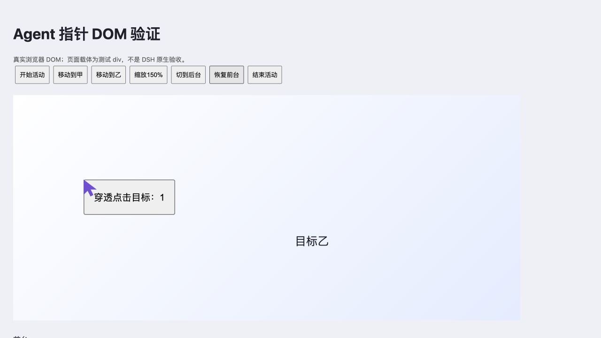

# 独立指针反馈与输入协调

2026-10-20，本地浏览器体验补充访谈 Q1–Q5 已整体确认。本轮实现首阶段的独立指针、活动显隐及动画等待后的输入复核；不代表完整首版、任意页面缩放或新构建的真实 Desktop 验收通过。参考依据见 [Codex 本地 IAB 调研](codex-iab-reference-2026-10-20.md)，取舍见 [ADR 0005](../../../.agents/docs/adr/plugins/agent-browser/0005-pointer-feedback-boundary.md)。

## 已实现行为

- 指针是自有 webview 同父容器中的 `24 × 24` CSS 图形，叠层裁剪在页面内并设置 `pointer-events:none`、`aria-hidden=true`；不移动系统鼠标、不向网页注册观察器或输入监听。
- 每页独立保存位置，首次活动默认显示在视口 `58% × 55%` 附近。可见页通过宿主帧时钟移动，最多等待 `1500ms`；后台、未获焦窗口、缺少帧时钟或减少动态效果时直接定位。
- 正式 `uiSession.sessionStatus` 的运行状态使指针在本轮工具间停顿中保留；会话停止时清除本轮浏览活动，下一轮无关任务不会复活旧指针。没有该公开状态的旧实验装配仅在单次工具执行期间显示。
- 当前会话/标签归属只用于视觉判断，不能授予工具权限。隐藏页由既有 Client 心跳刷新，不另建后台轮询；页面可见时的帧只读自有几何。
- 叠层与 webview 共享相对定位容器及祖先 CSS 变换，不把屏幕边界再次乘入目标坐标。原生输入仍要求已经验证的 `getZoomFactor()===1`；本轮不扩展页面内容缩放支持。
- 导航和页面替换清除旧位置与图形；取消、接管、关闭、卸载及时结束动画和等待者。帧代次拒绝迟到回调，旧动作的取消不能隐藏新移动。
- 纯视觉故障只降级展示，固定的每次输入后 `500ms` 指针等待已移除。动画结束后再进入输入发送登记，重新检查 Host 许可、文档、完整目标绑定与实际命中；视觉结果不代替审批或网页业务确认。

实现来源：[指针控制器](../src/agent-pointer.ts)、[Client 集成](../src/fixed-page-client.ts)、[官方源码增强补丁](../upstream/enhancement.patch)。普通人工浏览与既有输入焦点/选区复核继续使用当前正式输入契约；没有添加“检测用户正在编辑就自动让步”的规则，也没有引入 Codex 私有 CDP 参数。

## 回归范围

[指针回归](../test/agent-pointer.test.ts)使用独立 DOM/帧时钟边界，覆盖持续位置与穿透点击设置、移动中间帧、旧等待结算、后台/未获焦跳过等待、视口变化及祖先缩放不重复换算、1500ms 上限、取消/关闭与迟到帧、视觉载体失败、导航清理。

[真实工具边界回归](../test/native-input.test.ts)组合既有 Broker、正式审批适配、认证 Connection 与 Client，原生 guest 和宿主 DOM 仍为替身。新增覆盖指针缺失仍须正式审批、会话结束隐藏且新轮不复活、动画期间人工滚动使目标失效、接管立即撤销未发出输入。这些测试不能作为实际 Electron 页面或系统鼠标的验证。

## 实际验证与剩余边界

2026-10-20 本轮验证结果见[检查与 DOM 证据](evidence/agent-pointer-validation.json)：

- `fnm exec --using=24.19.0 pnpm check` 通过，包括事项索引、ESLint、类型检查、增强补丁准备、构建和测试；27 个测试文件通过，1 个跳过，共 201 项通过、6 项跳过。
- `fnm exec --using=24.19.0 node tools/verify-official-browser-reuse.ts` 单独运行通过，6 项全部通过。它是固定官方发布包的受控复用实验，不能当作增强插件的真实原生验收。
- 使用最终 `agent-pointer.ts` 转译模块，在实际浏览器中以 `720 × 320` 的测试 div 充当页面载体，验证指针到达、穿透点击计数为 1、祖先缩放到 150% 后叠层宽度仍为 `720px`，以及后台定位、前台恢复、活动结束隐藏。这里的“后台”由测试按钮切换控制器的前台判定，未验证真实 Desktop 会话切换或操作系统焦点。
- 验证使用已安装的 Node `24.19.0`、pnpm `11.7.0`；仓库要求 Node `24.21.0`，命令有版本不匹配警告，未将当前环境写成符合该版本要求。

下图展示真实 DOM 中 150% 祖先缩放下的指针和成功的穿透点击；载体为测试 div。

本轮构建指纹为 `7a352c17250a`，产物及源文件摘要保存在上述 JSON；该记录只证明本轮检查与独立 DOM 验证。需要真实 Desktop 验收时仍遵守[冻结构建和运行身份核对](verification.md#从检查到真实交付)。历史静态 `↖ Agent` 的原生证据只对应旧构建，不能继承为新指针的通过记录。

新的可见动效、侧栏缩放、切换标签/会话、后台执行及真实接管仍须在同一冻结构建的 macOS 官方 Desktop 中验收。无法在不干扰其他活跃任务的前提下更新宿主时，保留这一未测边界，不重启应用或把受控回归包装成原生通过。

## 2026-10-20：#6 限定原生验收通过

此前 `7a352c17250a` 的检查与 div 演示保留为历史记录。本轮 #6 已使用冻结构建 `434c25a0e1af`，通过官方插件管理器从根包安装、启用并正常重开，在 macOS `27.0.1`、官方 DSH Desktop `0.2.1-rc.2`、GPT-6.1-Sol 的自有会话“浏览器搜索杭州词条验收”执行正式工具。运行前后只读核对均为该指纹，Host 就绪、注册返回 `200`；原生执行期间未重建。包名、Host/Client 摘要、动作与截图摘要见 [#6 本轮证据](evidence/agent-pointer-slice6-verification.json)。

正式逐次“允许一次”批准 `fill Hangzhou` 和 `click-element Search`，各返回一次 `issued`；同一侧栏共享页面实际到达 `https://en.wikipedia.org/wiki/Hangzhou`。两次审批、获准操作和四次各 `2000ms` 的 `console` 之间持续显示紫色 Agent 指针，系统白鼠标可独立位于聊天区。任务运行时人工点击紫指针所在搜索框，AX 确认焦点为 `Search Wikipedia`，`Hangzhou` 不变，证明叠层未拦截该次人工点击。没有人工接管或交回。

任务用时2分10秒，结束后指针隐藏；下一轮不用工具、解释 HTTP 的无关任务运行约3–4秒时，旧指针仍未显示。

| 可核验结果 | 截图 |
| --- | --- |
| 获准填写后的搜索框及独立指针 | [填写](evidence/slice6-approved-fill.png) |
| 人工点击搜索框，指针叠层穿透 | [人工点击](evidence/slice6-click-through.png) |
| 获准 Search 后到达 Hangzhou 词条 | [点击结果](evidence/slice6-search-click.png) |
| 本轮停止后指针隐藏 | [停止](evidence/slice6-stopped.png) |
| 新轮无关任务没有复活旧指针 | [无关任务](evidence/slice6-unrelated-turn.png) |

失败与受限尝试分别保留：旧冻结构建 `20f2b3eceaa8` 的首次导航无地址契约缺陷曾产生 `unknown`，本轮已用 `892fa20` 修复并取得正式工具链红绿回归；该失败轮不计为通过。新构建的固定夹具含合成 password，因此点击被正确保护拒绝。随后 Wikipedia 首次填写因自有新会话的完全权限模式使审批不可用而被 `approval-rejected`，没有发送输入；仅将本自有会话收紧为“工作区内修改”，重新观察后再申请正式逐次批准，才取得上述成功结果。

工程检查使用 Node `24.21.0`、pnpm `11.7.0`：修复前候选基线为201通过、6跳过；修复后的 `pnpm check` 为205通过、0失败、6跳过。固定官方包复用验证单独6项通过，只证明其受控复用边界。

此记录仅完成 #6 的限定验证；#7 的竞争与接管、#8 的跨标签/后台/布局生命周期及 #9 的最终整合验收仍须各自完成，用户体验验收也未据此宣称通过。历史 div 或本切片结果都不能替代这些条件。

## 2026-10-20：最终集成构建已加载，原生验收未完成

最终集成代码为 `ca7b9f1`，冻结构建为 `db72c1c7cff9`；通过官方插件管理器从主仓库根包安装、启用并正常重开。macOS `27.0.1`、官方 DSH Desktop `0.2.1-rc.2`、GPT-6.1-Sol 的自有会话已可体验该构建。运行前后只读核对均为相同指纹，Host 就绪、注册 `200`、错误为空；任务后的磁盘 Host/Client 摘要与冻结记录完全一致。原生期间未改源码或重建。完整身份、步骤、动作状态与截图摘要见 [最终集成证据](evidence/agent-pointer-integration-verification.json)。

工程验证已完成：规范与规格两轴最终代码发现均为 0；初审文档成员覆盖问题已修复。Node `24.21.0`、pnpm `11.7.0` 下 `pnpm check` 为218通过、0失败、6跳过（28个文件通过、1个跳过）；单独固定官方包复用验证为6通过、0失败、0跳过。正式工具链、DOM 与原生 guest 替身回归只证明受控边界，不等同于下列 Desktop 原生场景通过。冻结后只补中文记录与必要截图，并定向运行文档 ESLint，不再修改源码或重建产物。

| 本轮原生场景 | 实际结果及范围 |
| --- | --- |
| 可控页正式获准点击与模拟提交 | 更新状态先后为1、2，模拟提交次数为1；工具均为 `issued`，对应可信原生事件均为 `true`。 |
| 显式人工接管与交回 | 真实按钮 ACK 显示“已接管、Agent 已暂停”，指针隐藏；随后正式 `observe` 拒绝“该页处于人工接管”。交回 ACK 为工具就绪，新 `observe` 成功，未复用接管前引用。此项只证明静态接管屏障及交回。 |
| 真实后台标签 | 显式 `pageId` 的两次 `observe` 与中间3次各 `2000ms` 的 `console` 成功，仍为同一文档。前台人工新建的空白标签始终选中、无指针，未被抢回；结束后人工关闭该自有空白标签。 |
| 真实侧栏尺寸变化 | 分隔线从 `x1408` 拖至 `x1160`，页面真实重排；随后正式获准的填写、Search 与 Prefecture-level 点击均成功。限定通过真实尺寸变化后的输入；原生 `150%` CSS transform 未测，`150%` 只由受控回归覆盖。 |
| 真实会话切换 | 原页只读任务启动后，真实新建空白自有会话，未显示原共享页或其指针；返回原会话仍为同一 URL。未取得按下取消时任务仍在运行的证据，此项不证明取消通过。 |
| 窗口切离与返回 | `CmdTab` 切离，再点击标题回到 DSH，原网页保留。未命中移动动画的失焦阶段，完整实际窗口焦点等待矩阵仍未验证。 |
| 动画期间滚动、取消与接管 | 未验证。CUA 调用返回时输入已完成，点击为 `issued` 且页面计数增加；没有命中“动画等待且尚未发送”的精确阶段，不能证明旧目标拒绝、零原生事件或 `not-started`。 |

可控页仅含自有测试内容；人工已移除合成 password、OTP 和 frame。正式点击已发送与随后静态接管成功分别记录，不能将后者写成在途输入撤销。

公开网站连续任务已在同一最终构建与尺寸变化后的布局中完成。初始导航 Wikipedia 返回 `loading=true` 后以 `observe` 确认；正式逐次允许一次填写 `Hangzhou`，`issued` 后观察确认。随后正式批准 Search，实际到达 [Hangzhou](https://en.wikipedia.org/wiki/Hangzhou)；再正式批准点击页面中的 Prefecture-level 链接，实际到达 [Prefecture-level city](https://en.wikipedia.org/wiki/Prefecture-level_city)。读取新词条标题和简介后，正式同页 `back` 并观察确认 Hangzhou，再 `forward` 并观察确认 Prefecture-level city。没有用直接导航代替链接点击，正常路径接管、交回均为0，未重发任何已 `issued` 的写动作。

该任务存在两次等待审批超时：首次 Search 未获允许，首次 Prefecture-level 未点击且未离开杭州。两次都重新 `observe` 取得新引用、明确提出新请求并重新逐次批准，才完成上述 `issued` 点击，不能写成全程无错。最终自有主会话保留标题为 `Prefecture-level city - Wikipedia` 的词条；观察确认其简介和来源不足提示。任务后身份核对完成，仍是 `db72c1c7cff9`。

| 可核验结果 | 截图 |
| --- | --- |
| 接管后的暂停 ACK 与保留页面 | [人工接管](evidence/final-takeover.png) |
| 后台观察期间前台空白标签保持选中 | [后台标签](evidence/final-background-tab.png) |
| 侧栏改变后真实页面重排 | [侧栏尺寸](evidence/final-layout-resize.png) |
| 最终链接点击、读取、后退及前进后的保留页面 | [连续任务完成](evidence/final-public-complete.png) |
| 真实新空白会话未显示原页 | [会话切换](evidence/final-session-switch.png) |

**交付仍未完成。** #5、#7、#8、#9 保持未完成，PR #10 保持 draft。主要阻塞是最终构建中的真实动画竞争尚未命中：需要在移动等待且输入尚未发送的精确阶段执行滚动/目标变化、取消与接管，分别取得旧目标拒绝且零原生事件、`not-started` 及可靠结算证据。两次竞争尝试均已输入并使计数增加，不能算通过。还缺完整实际窗口焦点等待矩阵、位置恢复，以及导航/实例替换和关闭/卸载中的迟到回调清理验证。当前保留已加载插件以供体验，尚未执行卸载。本轮未逐项重新验证的人工点击穿透、系统鼠标独立、工具停顿、会话结束与无关新轮完整矩阵不能直接继承 #6 旧构建结果。

当前状态分别为：规格已确认，候选代码已实现并完成双轴审查，自动检查通过，最终构建已加载，连续公开网站任务已完成但有审批超时偏差，完整原生验收未完成，用户体验验收为 `pending`。剩余人工时序验收针对上述精确阶段，代码审查与可自主执行的工程验证已经完成，不转交用户承担。

完成门槛保留：同一冻结构建下的必需场景须各有原生结果；自动回归、div 演示、静态接管或历史切片不能替代。当前可交付的是已加载的可体验版本及明确缺口，不能关闭上述事项。
