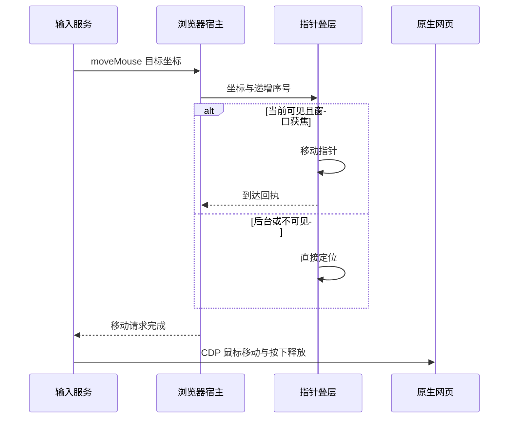

# Codex 本地内置浏览器参考

调研日期：2026-10-20。用户明确以本地内置浏览器（IAB）为参考，本报告聚焦虚拟指针、原生网页输入、人机共同操作、视口与生命周期。

## 结论与适用范围

**本地实现有明确可参考的机制：指针展示、网页输入、Agent 活跃状态和交互阻断分别管理。** 虚拟指针是宿主 DOM 叠层，真实网页操作走独立输入通道；可见页面没有因为 Agent 活跃而在 renderer 中整体锁住。这支持低打扰的人机共同浏览设计，但不代表两套独立页面焦点或表单状态。[指针实现](/tmp/codex-iab-pointer/cursor-chat-8fbee25b99d9.js:1)、[浏览器容器](/tmp/codex-iab-pointer/app-shared-52443cbe9ac4.js:404)、[输入服务](/Users/pzehrel/Downloads/codex-tools/node_modules/@oai/browser-desktop/scripts/browser-service.mjs:8900)。

样本是 Codex `26.1013.40934`、build `20770`。用户提取目录漏掉了不含 browser 关键词的关键前端 chunk；本轮只读同版本 `/Applications/ChatGPT.app` 补查，主 bundle 与提取副本逐字节相同，完整 ASAR 的 SHA-256 也与提取来源记录相同。没有启动提取服务或对真实网页执行操作。[提取范围与来源](/Users/pzehrel/Downloads/codex-tools/README.md)、[来源记录](/Users/pzehrel/Downloads/codex-tools/origins.json)。

正文的 **观察** 来自静态文件，**推断** 是对这些机制的解释，**建议** 是本插件可采用的设计。原生框架的完整输入仲裁仍未反编译或实测；这一未决项不影响已经查清的指针与 renderer 机制。

## 虚拟指针怎样工作

**观察。** `cursor-chat-8fbee25b99d9.js` 的 `l()` 在宿主文档创建绝对定位叠层，设置 `aria-hidden=true`、`pointerEvents=none`、`zIndex=20`，内部使用不可拖动图片。`VAn` 将 `<webview>` 与 `cursorOverlayHost` 创建为兄弟元素。这段指针动画不移动系统鼠标，也不负责向网页派发点击。[指针 DOM，字符偏移 1357](/tmp/codex-iab-pointer/cursor-chat-8fbee25b99d9.js:1)、[浏览器容器](/tmp/codex-iab-pointer/app-shared-52443cbe9ac4.js:404)。

**观察。** 指针持有位置、旋转、伸缩、显隐弹簧和当前运动路径。距离不超过 `196` 使用短距离移动，较远时使用贝塞尔路径。第一次出现、禁用动画或距离小于 `0.5` 时直接定位；正常移动到达后回调 `onArrived(moveSequence)`，按 `turnKey + moveSequence` 去重。销毁时取消动画帧并移除叠层。视觉尺寸为 `24 × 24`。[指针状态与动画，字符偏移 153、2615、9369](/tmp/codex-iab-pointer/cursor-chat-8fbee25b99d9.js:1)。

**观察。** 侧栏与独立浏览器窗口复用同一指针控制器。指针状态包括 `x/y`、`visible`、`animateMovement`、`moveSequence` 和 `sessionConversationId`；renderer 的 turn key 还带当前会话和活跃状态，避免切换会话后沿用旧动画。转为 inactive 时隐藏指针并保留坐标。[侧栏控制器](/tmp/codex-iab-pointer/tab-content-7c67db6bbf0d.js:2)、[独立窗口](/tmp/codex-iab-pointer/page-d8a8f66aa22c.js:2)、[状态存储](/tmp/codex-iab-pointer/app-initial-90eb42395b7d.js:2576)。

## 指针动画与真实输入的顺序

下面展示普通点击的两条通道，以及可见动画的到达确认。

**观察。** 普通点击先 `await ui.moveMouse()`，再发送 CDP `Input.dispatchMouseEvent`。IAB 使用 `mouseWheel` 分支完成滚动。拖动起点正常等待，后续轨迹设置 `waitForArrival:false`，逐点发送真实输入，不逐点等待视觉动画。异常路径尝试释放已经按下的鼠标，避免遗留按下状态。[输入服务，字符偏移 1670932、1672040、1672883、1673386、1675564](/Users/pzehrel/Downloads/codex-tools/node_modules/@oai/browser-desktop/scripts/browser-service.mjs:8900)、[IAB 分支选择，字符偏移 1740626](/Users/pzehrel/Downloads/codex-tools/node_modules/@oai/browser-desktop/scripts/browser-service.mjs:8914)。

**观察。** 宿主递增 `moveSequence`，默认最多等待 `1500ms`；动画回执检查会话路由与窗口 owner。窗口未获焦、当前会话或标签不匹配、页面不可见等情况下，宿主设置 `animateMovement:false`，不等待可见动画。超时本身不抛异常，工具 UI 适配器也吞掉指针展示错误，所以动画到达不是网页动作许可或成功证明。[宿主 `moveMouse`、`waitForCursorArrival`、`oq/sNe`，字符偏移 1799370、1803965、1956956、1958326](/Users/pzehrel/Downloads/codex-tools/application/asar/.vite/build/main-CLu1A25j.js:1003)、[UI 适配器，字符偏移 1699419](/Users/pzehrel/Downloads/codex-tools/node_modules/@oai/browser-desktop/scripts/browser-service.mjs:8910)。

**建议。** 本插件可以采用独立指针状态和带序号的可见反馈，但不能让“指针到了”解除审批、目标复核、取消或人工接管。后台任务继续运行时跳过视觉等待；显示失败与输入授权失败使用各自的处理规则。

## 用户能否继续操作

**观察。** `TAn()` 的可见容器设 `pointerEvents: c ? none : auto`、`inert=c`。正常可见分支传入的是 `state.isExiting`，并非 `isBrowserUseActive`。`setBrowserUseActive()` 记录活跃状态并重算布局；`blockInteraction()/restoreInteraction()` 是另一个独立开关。隐藏页面的 `pointerEvents:none` 用于后台绘制，不能解释成 Agent 工作时锁住用户。[浏览器容器，字符偏移 4375502、4383142、4387445、4389497](/tmp/codex-iab-pointer/app-shared-52443cbe9ac4.js:404)。

**观察。** 主进程的普通 `mouseDown` 监听在页面可见、已呈现时通知 owner：`browser-sidebar-web-contents-pointer-down`。该监听没有清除 Agent active 或调用 `preventDefault()`。同处键盘监听还处理注释模式与快捷键，不能把这些功能的禁用条件当作整个网页的输入锁。[宿主输入监听，字符偏移约 1923780](/Users/pzehrel/Downloads/codex-tools/application/asar/.vite/build/main-CLu1A25j.js:1003)。

**推断。** 可见 DOM 与工具输入路径支持用户鼠标入口、Agent 虚拟指针和网页自动化共同存在。独立指针解决的是视觉与系统鼠标争用，页面滚动、焦点、选区、表单和导航仍是共享状态。不能由此推出人机同时在不同字段输入永远互不干扰。

## 焦点与目标过期怎样处理

**观察。** IAB 的 locator 输入路径生成 UUID token，聚焦并验证目标后，将 `__codexIabInputTargetToken` 放在元素上。后续部分 CDP 键盘输入携带 `__codexIabExpectedInputTargetToken`。虚拟剪贴板另有页面端检查：文档必须获焦，当前元素 token 必须匹配，否则报 `Active element is no longer the expected input target`。直接坐标键盘 API 并非全部经过这套 token 准备流程。[token 与键盘参数](/Users/pzehrel/Downloads/codex-tools/node_modules/@oai/browser-desktop/scripts/browser-service.mjs:5481)、[粘贴前验证](/Users/pzehrel/Downloads/codex-tools/node_modules/@oai/browser-desktop/scripts/browser-service.mjs:5503)、[locator 聚焦与填写准备](/Users/pzehrel/Downloads/codex-tools/node_modules/@oai/browser-desktop/scripts/browser-service.mjs:5839)、[元素标记](/Users/pzehrel/Downloads/codex-tools/node_modules/@oai/browser-desktop/scripts/browser-service.mjs:6180)。

**观察。** AX 层为同标签的输入维护 `pendingInput`，后续相应操作等待前一个输入；虚拟剪贴板使用 `operationTail` 串行。点击、拖动与按键还有取消和释放处理。这些是局部输入协调，不能概括成所有调用均有统一全局锁。[AX 输入协调](/Users/pzehrel/Downloads/codex-tools/node_modules/@oai/browser-desktop/scripts/browser-service.mjs:5765)、[虚拟剪贴板串行](/Users/pzehrel/Downloads/codex-tools/node_modules/@oai/browser-desktop/scripts/browser-service.mjs:8914)。

**观察：主动聚焦不等于人类编辑优先。** 定位式输入准备阶段会调用 injected `focusNode()`，某些 contenteditable 情况下先将旧元素 `blur()`，再两次调用目标的 `focus()`。`pressSequentially` 也先主动聚焦，此后每个字符前核对目标令牌、焦点和 frame 链路；失效时报告 `pressSequentially target changed or lost focus while typing`，检查设置 `retry:false`，不在该循环中重新抢焦点。因而可确定“先聚焦目标，执行中失去目标则失败”，不能替换为“检测到人正在编辑就不执行”。[聚焦实现，字符偏移 1524608](/Users/pzehrel/Downloads/codex-tools/node_modules/@oai/browser-desktop/scripts/browser-service.mjs:5770)、[逐字输入准备，字符偏移 1558354](/Users/pzehrel/Downloads/codex-tools/node_modules/@oai/browser-desktop/scripts/browser-service.mjs:5839)、[逐字检查，字符偏移 1300480](/Users/pzehrel/Downloads/codex-tools/node_modules/@oai/browser-desktop/scripts/browser-service.mjs:5765)。

**观察：输入 API 的保护不同。** `cua.type` 向当下 activeElement/selection 粘贴，不预先定位或生成目标令牌；虚拟粘贴的 token 检查在令牌为空时直接返回。`cua.keypress` 同样不能概括为每次都绑定一个新目标。即使定位式输入附有 token，用户在同一个已标记元素键入也不会自动更换该 token，因此它不保证同框人机输入不会交错。[当前焦点输入](/Users/pzehrel/Downloads/codex-tools/node_modules/@oai/browser-desktop/scripts/browser-service.mjs:5540)、[粘贴令牌验证](/Users/pzehrel/Downloads/codex-tools/node_modules/@oai/browser-desktop/scripts/browser-service.mjs:5503)、[直接按键](/Users/pzehrel/Downloads/codex-tools/node_modules/@oai/browser-desktop/scripts/browser-service.mjs:5525)。

**待验证。** 在已查工具服务中，`compositionstart`、`compositionend`、`isComposing`、`userEditing` 没有匹配，不能因此否定原生层另有输入法或人类介入处理。CDP expected token 在工具服务中只被写入并随完整参数传出，未找到消费或删除它的中间层；页面虚拟剪贴板则有直接可见的 token 校验。最终 CDP 字段的宿主校验与原生抢占仍须独立取证。[CDP 参数构造](/Users/pzehrel/Downloads/codex-tools/node_modules/@oai/browser-desktop/scripts/browser-service.mjs:5481)、[参数转发](/Users/pzehrel/Downloads/codex-tools/node_modules/@oai/browser-desktop/scripts/browser-service.mjs:5758)、[会话请求传输](/Users/pzehrel/Downloads/codex-tools/node_modules/@oai/browser-desktop/scripts/browser-service.mjs:8930)。

**建议。** 可借鉴“输入绑定确切目标、焦点变化后拒绝误填、已按下事件必须清理”的机制。两个 `__codexIab...` 名称属于该发布产物的专用实现，不能作为已验证的官方 DSH CDP 或输入接口照搬。本插件应继续使用已验证的公开原生输入与自身目标绑定。[本插件输入复核](../src/fixed-page-client.ts)、[正式宿主边界](design.md#页面身份与操作一致性)。

## 坐标、缩放与后台存活

**观察。** 宿主 `AAn()` 使叠层与 webview 采用相同视口宽高、缩放和 `transformOrigin: top left`。指针坐标夹在视口范围内；输入坐标检查依据 `Page.getLayoutMetrics().cssVisualViewport`，IAB 鼠标输入取整。截图分辨率另有设备像素比处理，不能直接把截图像素当作输入 CSS 坐标。[叠层布局，字符偏移 4376725](/tmp/codex-iab-pointer/app-shared-52443cbe9ac4.js:404)、[指针边界，字符偏移 6110](/tmp/codex-iab-pointer/cursor-chat-8fbee25b99d9.js:1)、[输入视口检查](/Users/pzehrel/Downloads/codex-tools/node_modules/@oai/browser-desktop/scripts/browser-service.mjs:5765)、[截图比例](/Users/pzehrel/Downloads/codex-tools/node_modules/@oai/browser-desktop/scripts/browser-service.mjs:5559)。

**观察。** 活跃后台页面有保留绘制表面的分支，隐藏布局采用极低不透明度和禁止鼠标命中；这与可见页面的输入设置不同。轮次结束、释放、转移和关闭分别清理控制状态、调试连接或指针，不能把收起侧栏直接等同于关闭网页。[隐藏绘制与可见布局](/tmp/codex-iab-pointer/app-shared-52443cbe9ac4.js:404)、[指针状态生命周期](/tmp/codex-iab-pointer/app-initial-90eb42395b7d.js:2576)、[宿主控制释放](/Users/pzehrel/Downloads/codex-tools/application/asar/.vite/build/main-CLu1A25j.js:1003)。

**建议。** 复用其可见性判断与坐标同步思路；不要直接复制极低不透明度绘制技巧。DSH 当前已有自己的保活与页面生命周期契约，需要按正式接口验证后台执行和截图。[本插件生命周期验证](page-lifecycle-validation.md)。

## 对当前插件的具体参考

本插件已经有独立于系统鼠标、可穿透点击的 `↖ Agent` 宿主标记。`showAgentPointer()` 按动作创建节点，以 webview 当前边界加目标坐标定位；`showPointerFrame()` 提供 `500ms` 最短显示窗口；取消时移除节点。当前还不是 Codex 那种持续位置状态与移动动画。[现有指针实现](../src/native-input.ts)、[调用与输入执行](../src/fixed-page-client.ts)。

| 可参考机制 | 当前基础 | 最小可实施改进与验证 |
| --- | --- | --- |
| 持续指针状态 | 每次动作创建静态标记 | 按页面保存位置与序号；覆盖同页连续动作、切页清理和取消。 |
| 穿透点击的独立叠层 | 已有 `pointerEvents:none` | 保留宿主叠层与网页输入分离，检查用户点击不会被标记截获。 |
| 视口和缩放同步 | 当前按边界加目标坐标，输入路径拒绝不确定缩放 | 统一叠层与输入的坐标映射，验证缩放、侧栏尺寸变化和后台切回。 |
| 可见反馈与后台执行分开 | 固定最短显示窗口 | 只对可见页面等待运动；后台跳过等待，验证不会抢回当前会话。 |
| 目标变化后拒绝误输入 | 已有批准绑定、命中及焦点复核 | 保留现有检查，覆盖用户滚动、抢焦点、导航和取消与动画交错。 |
| 活跃状态与人工接管分开 | 已有 Broker 暂停代次 | 指针移动只服从页面控制状态，不新增普通滚动就强制交接的条件。 |

以上是后续实现建议，不是本轮新增产品行为。它与现有 [ADR 0004](../../../.agents/docs/adr/plugins/agent-browser/0004-human-agent-interaction.md) 的普通浏览允许人机并行一致，也没有取消显式人工接管。无需将所有 Codex 视觉动效作为第一步交付条件。

## 仍未解决的原生边界

宿主仍调用原生扩展 `webContents.setAgentActive()`。本轮已定位同版 `Codex Framework`，确认是 arm64 Mach-O，SHA-256 为 `2306fadc440e2ba60052eae9a5de05835c2c6e16d6ef5aae800b09a2746aaeed`，文件中存在 `setAgentActive` 绑定名称；没有完成其函数反编译，字符串和导出表不能证明实际输入仲裁。expected input token 的宿主强制校验、真实用户输入是否触发原生抢占、同一时刻的焦点竞争，仍需针对性原生分析或受控运行验证。[宿主调用](/Users/pzehrel/Downloads/codex-tools/application/asar/.vite/build/main-CLu1A25j.js:1003)、[原生框架](</Applications/ChatGPT.app/Contents/Frameworks/Codex Framework.framework/Codex Framework>)。

这些未知项只限定相关原生保证；不能再把已经补齐的 DOM 指针、动画握手或可见容器设置说成没有实现证据。

本轮补查尝试通过 Hopper 追踪 `setAgentActive`，但 REA 等待分析桥接就绪超时，未得到函数反编译或调用证据。本次新建的临时分析文档已在界面中停止反汇编并关闭；REA 的清理确认未收到，私有运行目录 `/tmp/rea-GmIWua` 仍由工具保留。该失败不改变上述静态结论，也不能作为原生仲裁行为的正反证据。

## 证据复核与文件指纹

补查源归档为 `/Applications/ChatGPT.app/Contents/Resources/app.asar`，SHA-256：`5ddc4e48259aa6f979e04529b1a5a4ae54b0f5c4ad6db5c6e004924c10916ddb`。以下临时副本按原成员字节提取，链接便于本轮检查；`/tmp` 不是永久归档，清理后可按原成员名和 SHA 重新定位。全部偏移均为从零开始的 Unicode 码点偏移。

| 原 ASAR 成员 | SHA-256 |
| --- | --- |
| `webview/assets/cursor-chat-8fbee25b99d9.js` | `47da78a8f7a6ede98579c64c2d596548b4b07b311349d6a80e3012c6803a9a60` |
| `webview/assets/app-shared-52443cbe9ac4.js` | `64e2b99444d28f5a0067e309a56912749763af09f9b27f083fce2d702a2b9fc3` |
| `webview/assets/tab-content-7c67db6bbf0d.js` | `c9b8278236f47a2ad8561fb1d932f335825216cae788a6220d24ca0302a2a279` |
| `webview/assets/page-d8a8f66aa22c.js` | `77ff9c3ab9fb4cb2a75d1996d3b3d3bd8bb37e4310e6bb71b47e277cca637c90` |
| `webview/assets/app-initial-90eb42395b7d.js` | `2687d59e8c67ccf81c7efb3820211070df303c6a200c9e0e8d604f26253f2f5e` |
| `.vite/build/main-CLu1A25j.js` | `8aedee047ec0a078e65b24dc917c64ad544220395e773feb6740f4447008a495` |

工具服务仍以用户提取的 `node_modules/@oai/browser-desktop/scripts/browser-service.mjs` 为准，SHA-256：`44594ea0a8238c09dfb46e28acdd610e5053a05011047e1c78fb98f210195a4e`。不能把其他随包副本的行号套在这份文件上。

REA 对单独指针文件的静态分析主证据为 `ev_b71bc7f2a8b000a5871267f5691bfb0cccfd9cf2e54e1d2697f7156d755a5d92`，摘要为 `ev_0c753d1faf1bf51a2a64739dda721e6bdb5492250f97efabfa4a92262c78b14a`；原生 Mach-O 元数据证据为 `ev_fee9671069c266074f945f1d2c28cd5a5896b865953930b9badd4ead3759f812`。单文件静态覆盖不等于整个应用调用图或运行验证。早先的接管名词辨析保留在[上一份报告](codex-human-takeover-research-2026-10-20.md)，本报告作为本地 IAB 实现参考。
