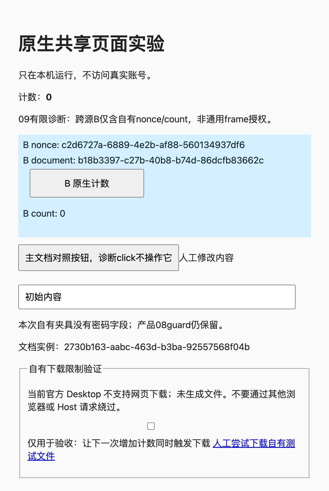

# 跨域 frame：公开路线与完整验收缺口

任务09保持阻塞。公开的截图、原生坐标输入和frame导航事件构成可验证的视觉候选；本次尚未取得同时满足实际frame、网站、文档和目标绑定的完整公开路径。跨域DOM不可读不是整个视觉路线不可行的证明，也不把明确拒绝误记为已交付。G4的frame部分及A11仍未通过；A04、A05与审批绑定的相关frame场景不能用主文档通过结果替代。

## 固定来源与已确认能力

核对对象为DSH `0.2.0-rc.2`、官方源码commit `639ed015397290b3745d163aafe02ffee4aa3f84`。其Desktop声明Electron `^44.0.0`，以下接口事实固定于Electron `v44.0.0`，并不单独证明当前安装包的实际行为。逐文件SHA核验覆盖本轮已有的38份公开Electron/Chromium来源，未重新广搜。

| 公开来源 | 正面事实 | 不能由此推出的能力 |
| --- | --- | --- |
| [web-view-methods.ts](https://github.com/electron/electron/blob/v44.0.0/lib/common/web-view-methods.ts#L65-L79) | `<webview>`公开异步表含`capturePage`、`executeJavaScript`、`sendToFrame`、`sendInputEvent`。 | 该表不提供frame定向执行、frame树或命中frame查询；不能从`getWebContentsId`拼接私有通路。 |
| [CapturePage](https://github.com/electron/electron/blob/v44.0.0/shell/browser/api/electron_api_web_contents.cc#L3999-L4050) | 截取当前guest显示surface；显示器比例大于1时增加位图尺寸。无surface拒绝，空视图可返回空图片。 | 图片像素不是frame身份或实际网站证明；PNG像素与CSS输入坐标不能直接混用。 |
| [SendInputEvent](https://github.com/electron/electron/blob/v44.0.0/shell/browser/api/electron_api_web_contents.cc#L3883-L3901) | 鼠标事件通过当前guest的RenderWidgetHost转发。 | 参数没有目标frame，也没有返回实际命中frame/文档；成功发送不等于网站业务完成。 |
| [web-view-events.ts](https://github.com/electron/electron/blob/v44.0.0/lib/browser/web-view-events.ts#L17-L28) | 导航事件给URL、main标记、process与routing标识。 | 没有parent关系、HTMLIFrameElement对应、坐标命中对象或永久document身份。 |
| [will-frame-navigate转发](https://github.com/electron/electron/blob/v44.0.0/lib/browser/guest-view-manager.ts#L176-L184) | 该事件独立转发，确实可用于保守撤销整页旧观察。 | 不能因它不在通用事件表就宣称事件不存在；它仍不提供目标区域到frame的对应。 |
| [sendToFrame文档](https://github.com/electron/electron/blob/v44.0.0/docs/api/webview-tag.md#webviewsendtoframeframeid-channel-args) | 向指定renderer发送IPC消息，接收方使用`ipcRenderer`。 | 不是任意frame脚本执行器；官方guest没有可供插件调用的Node/preload接收代理。 |
| [固定browser-guests.ts](https://github.com/deepseek-ai/deepseek-harness/blob/639ed015397290b3745d163aafe02ffee4aa3f84/apps/desktop/src/browser-guests.ts#L79-L94) | guest设置禁止Node、子frame Node及自定义preload，开启sandbox与webSecurity。 | 不能把`webFrame`、`webFrameMain`或main-process的完整WebContents对象假设成插件已经持有的公开服务。 |

本次关键固定文件SHA-256为：

| 文件 | SHA-256 |
| --- | --- |
| `electron_api_web_contents.cc` | `7fcd9b077959ef7b90da6d21424d13f9c976623a1cd7d421949904a1e40b45da` |
| `web-view-events.ts` | `ed7675603febebcc3de60b8fc2352b81b5f6b67ba76f36d233ae8f4eeca6f2dc` |
| `browser-guests.ts` | `5911d6bcbce79b68bd951d27da40bf8b8c9ab57b7d715dd0586d5e74e8e515f4` |

这些是源码能力证据。未把官方上游测试源码当作本轮实际运行测试。

## 为什么视觉候选尚不足以交付09

主文档能取得顶层iframe节点及其位置，但`src`是嵌入者声明，不能代表重定向后的实际文档或嵌套frame网站。多个同URL frame、节点同URL替换、跨域内部嵌套以及重定向可使事件身份与可见区域之间的映射不确定。网页自报nonce、title、postMessage或截图文字只能作为自有实验标记，不能升级为任意网站授权依据。

对任何frame导航都撤销整页观察是有效的保守策略，现有Client也会在公开导航事件后撤销私有文档代次。然而跨域文档内部可以在不导航时移动、替换或遮挡按钮。单靠process/routing标识、导航计数或前后截图相等，都不能证明坐标仍指向同一目标、同一文档。相同像素也不能证明frame实例未被同URL替换。

完整路线仍须证明：执行前从当前可见区域可靠定位实际目标frame及网站；核验文档、布局、viewport/zoom与命中；正式审批绑定该实际网站、文档、动作及内容；批准后重新检查，变化则撤销。公开的“截图后发送输入”没有原子目标验证事务，缩短间隔不能冒充竞态已解决。无法核实时必须拒绝，不能把顶层origin或DOM的`src`用作替代授权。

跨域像素可能包含密码、私信或付款信息，主文档DOM过滤不能覆盖它们。产品[截图实现](../src/screenshot.ts)继续拒绝含frame的普通截图；本任务没有删除这项保护。若采用视觉路线，还必须为必要采集建立明确授权和信息暴露说明，并继续服从统一Broker许可、人工接管、关闭、取消、附件保存结算与迟到结果丢弃；不能另开采集通道。

## 有限自有原生诊断

为分清“宿主可截取/命中跨源画面”与“完整目标绑定”，本次准备了独立诊断构建。它复用固定官方增强UI、同一guest、既有真实Agent工具、统一Client/Broker/Connection和正式附件保存，不新建浏览器、controller或脚本沙箱。

诊断只允许随机自有A夹具及其精确B nonce地址。A使用`127.0.0.1`，B展示地址使用`localhost`，服务只监听loopback。B仅展示nonce、文档随机标记与计数；服务记录原生事件的`isTrusted`及收到的nonce/count。只有公开事件中主frame与B确有不同processId时，才能记为OOPIF覆盖。

诊断版`read`只用于自有主文档和有界公开frame元数据，不是任意敏感frame观察授权。诊断`screenshot`仅在精确自有A/B上采用一次性限定捕获，随后仍走原Host正式附件存储、Client复核与正式image结果。产品`captureScreenshot`及其frame拒绝保留原样。诊断`click`沿既有固定夹具路径，在A命中该iframe的已知测试坐标发送原生事件；副作用严格限于自有计数，未走正式输入审批，不能算审批或通用视觉定位通过。

诊断构建指纹为`c4bd20f10cbe`；Host SHA-256为`c5752d106c3f4f4c1a1ee307fcc459ef949ef1773a548c6eeced2dd6760037bf`，Client为`b159859d8df73a17086932e84e96b51b3d4e298ad583cfa7cc535bbd35813292`。真实官方Desktop执行已取得下文的正面截图、原生点击负例及人工对照；没有将有限结果视为完整09成功。

首次候选因放在根`dist`而缺少`@deepseek-ai/dsh-tools`祖先依赖，官方管理器启用报`failed to import`，未创建页面、未执行读写。修正为插件自身`dist/native-probes/`下的相同字节候选，已验证完整正常Node模块导入，仅取得`apply`导出而未调用。没有修改loader、建立手工symlink或重启宿主。构建通过与模块导入通过仍不能代替真实Desktop验收。

## 状态与后续解除条件

09不标完成，相关验收框保留。当前阻塞的是完整公开目标映射与审批/变化绑定证据，并非宣称整个宿主永远不可能支持视觉跨域操作。有限截图或点击正面结果如成立，只解除其对应技术疑点，不能解除G4/A11。

需要的新证据应覆盖实际frame/网站/文档映射、重定向、同URL替换、内部重排、滚动/遮挡、viewport/zoom变化、审批期间目标变化，以及同一Broker的接管、关闭、取消和迟到结果。跨域DOM不可读不得报告为空页面成功；暂不支持的明确结果也不算09交付。完整首版与任务16仍等待这些保留要求。

本次产品改动仅为本报告与任务09状态说明，因此没有为文档缺口虚构行为测试。外部诊断保留固定脚本语法检查的失败/修正记录、构建及类型检查日志；它们不计作产品TDD或原生验收。正常产品源码按原始SHA恢复后再运行仓库完整检查，检查结果单独记录。

诊断激活追加记录：同包名更换物理位置后，真实管理器开关on但工具仍未运行，未创建页面或执行读写；没有将其误记为成功。随后使用独有源码标记正常重建全新包、指纹与Host/Client模块URL，并在正常Node及官方Electron run-as-node独立进程验证完整导入，均只取得`apply`导出而未调用。独立导入的实际版本为Electron `44.0.0`、Node `24.18.1`，它不是运行中Desktop激活成功的证据。

## 官方Desktop有限原生结果

2026-10-16，主代理通过官方管理器实装并运行revision2；真实Agent正式工具作用于同一可见guest。白名单[原生证据](evidence/cross-origin-frame-verification.json)记录页面身份、文档标记、公开事件、计数及图片摘要，不包含control、profile、密码或Cookie。

主frame的公开事件身份为process `293`、routing `13`，B为process `295`、routing `5`，因此本次真实覆盖跨进程OOPIF。A读取B的`contentWindow.document`抛`SecurityError`，未把它解释为空页面。CSS viewport为`576×859`、DPR `2`、zoom `1`，iframe边界为`[32,235.375,512,180]`。

正式截图附件与公开`readImage`结果一致：JPEG `1151×1718`、`171913`字节，SHA-256为`59a726cd66b4aa6a2efeb82dfc177ff44e6bebd158bef8059215cf566601324e`。主代理通过图片查看及外部官方Desktop画面对照，确认B nonce为`c2d6727a-6889-4e2b-af88-560134937df6`、B文档标记为`b18b3397-c27b-40b8-b74d-86dcfb83662c`，主文档标记为`2730b163-aabc-463d-b3ba-92557568f04b`；它们来自同一共享页。图片尺寸与2倍DPR相符并有surface边界取整，不能据此对其他缩放组合自动推导坐标。

诊断工具在已核对A命中iframe的固定B测试坐标发送公开`mouseDown`/`mouseUp`。工具没有返回错误，但同次计数为`0`，随后新`read`仍为`0`且可信标记为false；B服务器也没有点击记录。因此仅“事件发送返回”不能声称跨进程目标已执行。主代理随后使用人工CUA点击同一页、同一B文档的按钮，B服务器才记录count `1`、`isTrusted=true`；该记录严格归于人工对照，不能算Agent操作成功。

这证明本次组合能通过公开截图取得跨进程frame画面，但所试原生输入组合没有使B按钮生效。未将一个负例扩展为所有公开路线永久不可能，也未盲试一系列坐标或事件来掩盖结果。内部布局变化、同URL替换、重定向、正式frame审批、接管/关闭/取消的完整frame竞态没有因此通过；完整身份与审批绑定缺口仍独立阻塞。

## 点击路由与context-menu补查

为解释本次负例，仅补查固定版本的精确调用链，没有搜索或调用私有接口。Electron非offscreen鼠标路径调用当前guest主widget的`ForwardMouseEvent`。固定Chromium `152.0.7977.54`的[RenderWidgetHostImpl](https://chromium.googlesource.com/chromium/src/+/152.0.7977.54/content/browser/renderer_host/render_widget_host_impl.cc#1608)继续调用本widget的输入router；[InputRouterImpl](https://chromium.googlesource.com/chromium/src/+/152.0.7977.54/components/input/input_router_impl.cc#119)过滤、缩放后向该client的WidgetInputHandler派发。[RenderInputRouter的同名延迟方法](https://chromium.googlesource.com/chromium/src/+/152.0.7977.54/components/input/render_input_router.cc#653)只记录latency，不做跨frame命中。

真正的跨view目标查找在独立[RenderWidgetHostInputEventRouter](https://chromium.googlesource.com/chromium/src/+/152.0.7977.54/components/input/render_widget_host_input_event_router.cc#636)：先查目标，再转换到目标坐标并派发。Electron所用的公开非offscreen路径没有调用这一目标查找入口。`mouseMove`同属该公开鼠标分支，因此当前没有源码依据证明仅在down/up前加move能补上目标路由；未构造无根据的第三版候选。该调用差异与本次负例相符，但没有宣称已排除所有底层因素或所有其他公开路线。

`context-menu`确是另一个应核对的公开接缝。[webview文档](https://github.com/electron/electron/blob/v44.0.0/docs/api/webview-tag.md#event-context-menu)给出`x/y/pageURL/frameURL`等命中时字段；`frameURL`比顶层DOM的`src`更接近当时来源事实，但仍不能单独区分同URL的不同frame或文档代次。[main-process的webContents文档](https://github.com/electron/electron/blob/v44.0.0/docs/api/web-contents.md#event-context-menu)另有`params.frame`，不能将这个main-process对象假设成Client已经获得的WebFrameMain。

固定[content_converter.cc](https://github.com/electron/electron/blob/v44.0.0/shell/common/gin_converters/content_converter.cc#L91-L103)把`frame`设为不可枚举getter，普通可枚举字段没有process/routing/token/document身份；[frame_converter.cc](https://github.com/electron/electron/blob/v44.0.0/shell/common/gin_converters/frame_converter.cc#L53-L111)在main内懒取RenderFrameHost，导航或销毁后可为null。webview事件的params随后经guest事件转发跨IPC；公开webview文档没有该frame对象出口。本轮未据此取得Client侧实际frame身份的正面路径。

右键输入仍走同一公开鼠标分支，网站也可能处理右击；本轮没有为取得菜单而增加UI副作用。即便后续能观察准确的`frameURL`，仍需证明实例/文档绑定、变化复核和菜单清理，不能直接解除09阻塞。新增精确来源的URL、SHA-256和本轮实际结果一并列在原生证据中；没有把抓取源码等同于运行相应上游测试。

## 本次清理

主代理已关闭本次09自有标签，并通过官方管理器卸载`c4bd20f10cbe`诊断包，保留原legacy测试标签。实现代理核对自有B服务命令与PID后，仅向该PID `21501`发送SIGTERM；B端口`58174`和诊断Host的A端口`63517`随后均确认关闭。清理结果已写入原生证据。没有重启宿主、取消既有后台任务或触碰其他进程；产品源码继续保持基线SHA。
