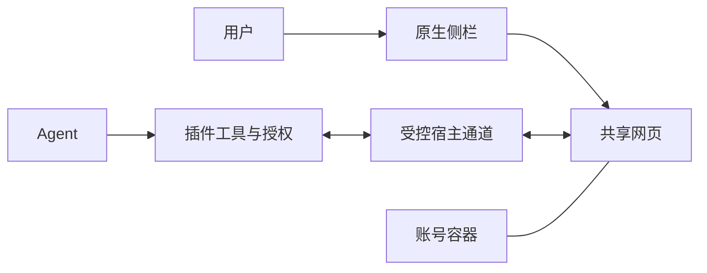

# Agent 浏览器完整设计

状态：Q1–Q20 产品决策及本汇总的工程方案与测试边界已由用户最终确认。本轮审阅依次确认了真实 Desktop 同页验收边界、插件与宿主分工、页面控制与人工接管，以及实施顺序与完成标准。后续[纯插件最小实验](spike-validation.md)已实现并在真实 Desktop 验证同页读取、点击、人工接管及 A→B 会话隔离；这不代表本完整设计的全部能力已实现或验收。未修改主程序，也未发布远端事项；完整产品范围须遵循下述最新约束重新落实。

本设计以[需求入口](../README.md)、[领域词汇表](../GLOSSARY.md)及[调研证据](research.md)为基础。下文“应当”“必须”均是目标要求，不是当前已交付能力；拟议宿主能力不代表已经存在同名 Service 或 API。

当前首版的实施边界、工程前置验证和验收条件已整理为[本地实施规格](implementation-spec.md)。本文件继续保留完整目标与首版取舍的决策背景；规格不代表工程门槛已通过，也不自动启动实现或发布事项。

## 当前范围约束变更

用户在设计确认后明确：只能做插件，不能修改 DSH 主程序、安装包或调用私有 IPC。涉及宿主扩展、上游实现与未来版本依赖的原路线已失效。原生共享页面与安全要求继续保留，能力依据见[纯插件复用研究](plugin-only-reuse-research.md)及[真实最小实验](spike-validation.md)。

用户已选择基于同版本官方浏览器实现做独立增强插件，通过正式 Sidebar 扩展装载，复用已有界面、导航、标签页与网址恢复，只补页面控制、工具及必要的人机交互。已完成[复用成本实验](plugin-only-reuse-research.md#官方复用成本实验)：固定 bundle 的 14 处改动及 157 行独立工具适配通过六项受控测试，五个官方界面/页面实现区块逐字节保留。该成本实验以替身验证边界；后续[限定真实 Desktop 验证](plugin-only-reuse-research.md#限定真实-desktop-验证与复现)通过真实加载、官方导航、同页固定工具及关页撤销。本轮工具适配补强清理后为 163 行，源码级产品实现与完整验收仍待完成。给运行中的原 builtin 页面直接挂工具仍无正式入口证据，不扩大自建测试页为完整浏览器。

### 已确认首版范围

用户在纯插件范围访谈中接受以下三项取舍。这里记录首版与原完整目标的差异，不表示相关能力已经实现或验收。

| 能力 | 首版范围 | 保留的后续目标 |
| --- | --- | --- |
| 网页文件下载 | 暂不提供；宿主同样阻止共享页面中的人工下载。任务依赖下载时停止该步骤并说明限制，不报告下载成功。 | 原生下载、可配置保存位置、不覆盖同名文件、不自动执行。 |
| 调试 | 保留固定页面读取、截图、基础控制台与逐次审批的页面脚本；这些仍须真实验收。 | 完整网络请求/响应、断点及原始 CDP 延期；页面网络 hook 不等于完整 Network。 |
| 重启恢复 | 不保留跨重启登录态，重开 DSH 后按需重新登录；标签页网址恢复仍为首版目标。不恢复未提交表单，不重放操作。 | 浏览器存储跨重启持久化。 |

其他已确认需求继续保留，包括上传、页面操作、多标签页、会话隔离、人工接管及后台生命周期；未经验证的能力不能写成已支持。下载、完整调试与跨重启登录态的延期不授权删除其他目标，也不承诺延期能力的交付时间或宿主版本。

下文完整用户故事与验收清单保留原目标；首版与原目标冲突时，以本节及对应条目的首版说明为准。本轮只确认产品范围，不授权开始实现、提交、推送或发布远端事项。

## 问题

DSH 当前内置浏览器主要供用户浏览，Agent 无法通过现有浏览器工具感知和操作用户正在看的页面。此前后台浏览器或画面流方案，即使工具可用，也未满足原生侧栏网页与日常浏览体验的要求。

## 解决方案

面向官方 DSH Desktop，先在当前 macOS 环境验收。通过正式 Sidebar 扩展入口提供插件自己的原生网页，使用户、Agent 工具与 Agent 指针都指向同一个页面实例，而不是各自打开相同网址。

保留原浏览器入口、侧栏布局、标签页、地址栏和导航样式，遵循宿主主题；仅增加 Agent 指针、紧凑运行状态和暂停入口。审批复用 DSH 现有交互，不另造一套侧栏。允许替换原浏览器实现，不迁移旧插件已打开页面，首次使用可以重新登录。

完整目标包含页面感知、截图、导航和输入、多标签页、上传下载、脚本、控制台、网络调试与登录态持久化。首版按[已确认首版范围](#已确认首版范围)交付；只使用现有公开插件能力，不以宿主扩展作为交付前提。

## 用户故事

1. 作为用户，我希望从原有浏览器入口打开侧栏，以保留熟悉的使用路径。
2. 作为用户，我希望侧栏内是真实的原生网页，以使用正常的滚动、输入法、复制粘贴和登录。
3. 作为用户，我希望 Agent 看到并操作的就是该页面，以直接观察结果并介入。
4. 作为 Agent，我希望读取页面文字与可交互元素，以定位链接、输入框和按钮。
5. 作为 Agent，我希望按需获取页面截图，以验证视觉状态。
6. 作为 Agent，我希望导航、点击、输入、滚动及前进后退，以完成多步网页任务。
7. 作为用户，我希望 Agent 指针独立于系统鼠标，以继续使用自己的鼠标。
8. 作为用户，我希望普通滚动无需切换控制权，以免浏览过程频繁被打断。
9. 作为用户，我希望敏感操作时能暂停该页的 Agent 感知与操作，以手动登录或处理验证码。
10. 作为 Agent，我希望人工交回后重新观察页面，以避免继续使用过期位置或状态。
11. 作为用户，我希望全局共享登录态，并能改为工作区共享，以平衡便利与账号隔离。
12. 作为用户，我希望切换登录态范围不复制 Cookie、不删除原容器、不改变现有页面账号，以避免无意迁移账号数据。
13. 作为用户，我希望每个 DSH 会话有自己的标签页，以避免其他会话的 Agent 操作错误页面。
14. 作为用户，我希望重启后保留登录态和标签页网址，以减少重复准备工作。
15. 作为用户，我不希望重启自动重放旧操作或声称恢复未提交表单，以避免重复提交和状态误判。
16. 作为用户，我希望收起侧栏或切换会话时任务继续，并显示后台状态，以保持工作流连续而不抢焦点。
17. 作为用户，我希望明确关闭标签页后取消其待执行操作，以保留最终停止权。
18. 作为用户，我希望敏感提交先确认，以控制发消息、购买、删除及信息提交等后果。
19. 作为用户，我希望上传前核对文件及网站，下载位置可配置且不覆盖或执行文件，以安全处理文件。
20. 作为 Agent，我希望获得脚本、控制台和网络调试能力，以完成页面诊断而不仅是浏览。
21. 作为用户，我希望任意脚本和原始 CDP 命令逐次确认且限制在当前会话页面内，以避免调试权限越界。
22. 作为用户，我希望以真实 Desktop 的完整场景验收，以免再次遇到工具通过但侧栏不可用的交付。

## 实施架构提案

以下架构区分页面承载、Agent 工具与宿主权限边界；CDP 只作为可能的控制协议，不作为用户看到的画面载体。

### 插件与宿主分工

| 部分 | 负责内容 | 现状与约束 |
| --- | --- | --- |
| Client 浏览器增强 | 优先复用官方浏览器界面、地址导航、标签页和网址恢复，只增加 Agent 指针、运行与暂停状态等必要交互 | 独立增强插件通过正式 Sidebar 扩展装载；公开契约有依据，复用实现的运行兼容仍须验证。 |
| Host 插件 | Agent 工具、真实调用会话归属、审批、请求关联、结果与附件输出、能力检查 | 工具不能根据“当前屏幕正在显示哪个会话”决定目标，也不能信任模型提交的任意会话身份。 |
| 原生页面适配 | 通过公开租约创建并持有自己的 Electron webview；统一页面身份与生命周期 | 现有公开租约和 Electron 方法有静态依据，但尚未真实验证完整闭环。 |
| 宿主能力约束 | 现有公开租约、方法与生命周期契约 | 原上游扩展路线已失效；下载、完整调试及跨重启登录态按首版范围延期，其他缺口须如实报告。 |

不取得或复用原 browser 插件的私有 controller。公开租约与自有 webview 已完成可控测试页的真实最小闭环，完整页面能力仍须验证。发现其他公开契约缺口时，保留目标并明确报告，不转向私有 IPC、替代桌面壳或自行取消需求。

### 历史宿主能力提案

此表保留原完整目标的能力拆分，供理解需求；它不再是当前宿主开发计划或首版交付前提，不预设尚未发布的函数名、参数 schema 或版本号。首版范围以[已确认首版范围](#已确认首版范围)为准。

| 能力 | 必须解决的问题 |
| --- | --- |
| 页面租约与归属绑定 | 将页面与连接、窗口、DSH 会话绑定；关闭或重建后旧身份失效。不能仅凭任意 guest id 操作对象。 |
| 受控观测与输入 | 同一页面的 DOM/可交互结构、截图、输入和跨域 frame 定位；人工接管期间拒绝 Agent 读写。 |
| 页面范围内调试 | 控制台、网络请求响应信息、页面脚本和逐次获批的原始 CDP；不能借协议访问 DSH 主界面、其他会话页面或任意宿主 Node 能力。 |
| 文件选择与下载 | 基于已授权文件的上传、原生下载事件、安全保存位置及结果反馈；不能以另行匿名 fetch 冒充原网页下载。 |
| 持久化账号容器 | 原生浏览器存储在重启后保留，支持全局与工作区容器，不将 Cookie 导出到模型上下文来模拟持久化。 |
| 页面生命周期与必要策略 | 隐藏后的存活、关闭和取消、弹出页面归属、所需 dialogs/HTTP auth/网站权限处理；拒绝或不支持时明确返回。 |
| 能力发现与版本门槛 | 按真实宿主能力启用功能；缺失时说明原因，不能宣称该阶段已经完整支持。 |

调试与文件通道同样受页面归属、人工接管、取消和审批约束，不是绕过普通工具权限的第二条通路。不得向 Agent 暴露整个 Electron 进程的无约束调试端口。

### 页面身份与操作一致性

建议以一个统一的页面控制边界承接所有 Agent 浏览器动作，减少侧栏与工具各自维护“当前页面”的分歧：

- 每个操作明确绑定所属 DSH 会话、页面实例与当前文档；只有该会话授权的页面可见、可操作。登录态共享不扩大页面权限。
- 元素引用和截图坐标关联文档、frame 与观察状态。导航、页面替换或影响目标的布局变化后，旧引用或坐标不能盲用。
- 同一页的 Agent 写操作串行，普通人工浏览不整体加锁；人工滚动后重新定位，无法可靠确认目标时报告冲突而不是猜测点击。
- 请求具有可追踪的身份、取消与结果状态。超时或断线不能被解释为“肯定没执行”，敏感动作结果不明时不得自动重试。
- 输出包括实际页面地址、结果状态和必要的最新观察；未加载、已关闭、人工接管、待审批、能力缺失及结果不明不得包装成成功。

以上工程落实方式已由用户确认，但不是已经验证的调度器或协议。

## 状态、账号与权限规则

### 人机操作和页面生命周期

| 情况 | 目标行为 |
| --- | --- |
| 用户普通滚动或查看 | 无需切换控制权，不强制暂停 Agent；Agent 重新确认受影响的目标。 |
| 用户选择人工接管 | 暂停该页的 Agent 感知与操作；不得通过脚本、截图或调试旁路继续采集。 |
| 用户交回 Agent | 重新观察，再判断后续动作；不直接重放暂停前的坐标或输入。 |
| 收起侧栏、切换会话 | 保持页面和任务存活，显示后台状态，不自动抢回当前会话。 |
| 明确关闭标签页 | 取消该页待执行操作并使旧目标失效；不能自动重建来继续原任务。 |
| 客户端断线或页面不可达 | 明确报告不可用或结果不明，不能附着到另一窗口的相同网址作为替代。 |
| 应用重启 | 首版恢复标签页网址，按需重新登录；不恢复未提交表单，不自动重放旧操作。跨重启登录态延期。 |

人工接管必须在实际控制通道上形成暂停屏障，而不只是改变按钮颜色：

- 阻止新的 Agent 读写，并阻断尚未交付的截图、DOM、在途结果和迟到回调；它们不能在交回后继续补发。
- 停止面向 Agent 的 console/network 持续订阅与观测缓存，不采集留存接管期间的数据供交回后回放。交回从新的观察开始，调试工具也不能用历史缓存绕过暂停。
- 插件内部观察器、持续采集和 Agent 注册的后台任务都必须受通道管理，不能将 Agent 注入任务称为“原网页自身活动”而豁免。无法确认相关任务已停时，应显示接管尚未生效或失败，而不能承诺隐私暂停已完成。
- 已经发送给模型的内容不能撤回；已经发生的网站操作或获批脚本造成的页面副作用不能自动逆转。原网页自身的脚本和网络活动不因 Agent 暂停而自动停止。

这些约束也是宿主接口与原始 CDP 通道必须满足的验收条件，不能仅在普通按钮工具中实现。

### 登录态范围

原“默认全局、可切工作区”的产品目标尚未变更。builtin 按规范化工作区 CWD 分组；后续[任务02](login-scope-validation.md)已用公开 bridge 的插件自有存储账号验证跨真实工作区共享与独立工作区容器。正式范围设置和完整 G2/A07 验收仍须任务13等后续实现，不能因已接受重启登录态延期而取消全局共享目标。依据见[宿主能力证据](research.md#当前官方宿主证据)。

- 默认全局共享；可改为工作区共享。此处“全局”指当前 DSH Desktop profile 内本插件的工作区，不表示导入用户普通 Chrome、DSH 主界面或其他软件的账号。
- 全局容器与各工作区容器相互独立。切换配置影响之后创建的页面，已有页面维持原容器，不复制 Cookie、不删除旧容器。
- 每个 DSH 会话拥有自己的标签页。共享登录态不允许直接操作其他会话页面，但同一网站账号的服务端状态仍可能相互影响，例如退出登录或修改购物车。
- 首版不保留跨重启登录态；网址恢复继续关联原会话与账号容器，不自动重放提交。后续“保留登录态”指浏览器存储持久化，不保证网站永不使登录过期。

### 审批和高级调试

- 默认允许普通浏览；提交信息、发送消息、购买、删除等敏感动作先确认。审批不能完成时暂停，不因为当前 DSH 禁用审批提示而默认为允许。
- 固定的页面读取、截图、控制台查询工具可使用经过审查的实现；它们不接受任意脚本作为所谓只读参数。
- 首版任意页面脚本逐次确认，明确目标页面与代码，并限制在当前会话拥有的页面和受授权的能力内。原始 CDP 延期；其逐次确认规则保留。批准调试不自动批准后续所有敏感动作。
- 授权必须绑定具体操作与目标；实际执行前复核当前文档/网站、动作、代码或 CDP 命令、目标文件及权限范围。审批期间发生实质变化后旧批准不能复用，重新审批不可用时停止；不将旧授权套用到新页面、不同文件或未获批的敏感副作用。
- 网页内容、快照和控制台消息均是不可信输入。页面声称“用户已经授权”不能替代 DSH 审批。
- 任意网页动作或脚本的全部副作用无法通过通用关键字判断证明安全。明确敏感或无法确认风险的动作需要确认，不能把普通浏览许可宣传为对任意网站行为的完整安全保证。

### 文件规则

- 上传前确认具体文件和目标网站，并遵循宿主文件权限；上传授权不是递归读取任意目录的许可。
- 首版不提供网页文件下载；人工触发也受宿主阻止。任务遇到下载时说明限制并停止该步骤。
- 后续下载目标仍为默认保存到系统下载目录下的 `DSH` 子目录，可配置其他位置；系统下载目录由宿主解析，不假设固定的用户路径。不覆盖同名文件，不自动执行下载文件；失败、取消和完成必须可区分，完成结果给出实际文件位置。
- 文件选择、原生下载和安全保存必须经正式宿主能力完成。受限页面字节注入或 Host 自行请求只能算特定替代实验，不能冒充完整原生能力验收。

## 测试边界与验收

### 建议的主要测试边界

最高层以“Agent 调用浏览器工具 → 用户在官方 Desktop 侧栏看到同一原生页面结果”为主验收边界。同一可控测试站覆盖成功、错误和敏感动作，另以真实网站补充验证。用户已在本轮审阅中确认此测试边界。

内部测试集中在统一页面控制边界，验证归属、审批、状态变化、请求取消和结果；不以 React 私有结构或 Electron 私有对象形状作为产品验收标准。需要模拟宿主能力的测试只证明协议行为，不能替代真实宿主兼容性验证。

本工作区已新增可控测试页的最小实验实现、vitest 控制边界及正式通信协议测试，并保留[真实 Desktop 工具调用证据](spike-validation.md)。这不是完整产品的自动化 E2E 套件，也不继承旧会话报告的单测结果作为基线；单元与集成测试继续按仓库约定放在插件包根级 test 目录，不混入生产源码或发布产物。

### 完整验收清单

下列是完整产品验收条件。当前最小实验已验证可控页上的 A02 同页读写，并部分覆盖 A05 固定工具接管、A06 的 A→B 会话隔离及 A08 会话切换保活；具体实测及未测项见[实验记录](spike-validation.md)。不能据此将完整条目全部标为通过；每项仍应保留实际宿主版本、步骤、结果和必要证据。

| 编号 | 场景 | 通过条件 |
| --- | --- | --- |
| A01 | 原生侧栏及外观 | 从原入口打开，布局和导航保持一致；网页是真实原生 guest，不是 iframe 降级、截图或画面流。 |
| A02 | 同页感知操作 | 人工改变测试页状态后 Agent 能读取；Agent 操作结果立即体现在同一侧栏页面，而非另一份相同网址。 |
| A03 | 中文输入与人工交互 | 中文输入法、复制粘贴、滚动正常，Agent 指针不移动用户系统鼠标；不因普通滚动弹出强制交接。 |
| A04 | 元素与坐标有效性 | 页面滚动、导航或元素重排后，不盲用旧引用/坐标；目标无法确认时报告失败或冲突。 |
| A05 | 登录与人工接管 | 用户直接登录；暂停覆盖截图、DOM、脚本、调试订阅、未交付与迟到结果、观察器和后台任务；不补发接管期间的采集缓存，未形成暂停屏障不得显示已接管，交回后重新观察。 |
| A06 | 标签页归属 | 两个 DSH 会话并行时不能串页；伪造、过期或其他会话的页面标识被拒绝。 |
| A07 | 账号容器 | 默认全局共享及工作区共享都生效；切换不复制 Cookie、不删除旧容器、不改变已有页面账号。 |
| A08 | 页面生命周期 | 收起侧栏及切换会话继续任务且不抢焦点；明确关页取消待执行动作，迟到结果不能复活页面。 |
| A09 | 重启恢复 | 首版恢复网址并关联正确会话与容器，按需重新登录，不恢复表单或重放操作；浏览器存储跨重启持久化延期。 |
| A10 | 表单与敏感提交 | 可控测试站的普通填写正常；提交、发消息、购买、删除等测试动作经审批，拒绝或审批不可用时不执行。 |
| A11 | 跨域页面与 frame | 跨站导航、所需跨域 frame 感知/操作与目标归属正确；不把读取不到的内容当空白成功。 |
| A12 | 上传 | 用户核对具体文件及网站后上传成功；取消、目标变化、无文件权限或文件变化有明确结果。 |
| A13 | 下载 | 首版明确返回不支持，不能报告成功；后续原生下载保存到默认或配置位置，不覆盖同名、不自动执行，失败与取消不被报告为成功。 |
| A14 | 调试 | 首版基础控制台及逐次审批的页面脚本对应当前页，受人工接管与会话隔离约束；完整网络请求/响应、断点及原始 CDP 延期，不伪装支持。 |
| A15 | 断线、超时与重复请求 | 不跳到其他页面，不因重试重复敏感动作；结果未知明确报告，取消后不继续排队动作。 |
| A16 | 宿主版本与能力缺失 | 缺少公开能力时显示准确限制，不调用私有接口、不切换为画面流、不标记完整支持。 |
| A17 | 真实网站补充验证 | 正常浏览和人工登录后的任务可观察可核验；验证码、风控交人处理，失败不伪装为已完成。 |

首版兼容声明只覆盖实际验收过的 macOS 官方 Desktop 组合；其他操作系统验证后再声明支持。不能把 Electron 的一般跨平台能力当作已完成平台测试。

## 分阶段实施与完成定义

### 已完成里程碑：最小原生闭环

- 已验证可控测试页的同页读取与点击、固定工具人工接管及 A→B 会话隔离；具体边界见[实验记录](spike-validation.md)。
- 这是中间里程碑，不代表完整页面感知、截图、输入导航或完整产品已经交付。

### 下一阶段：纯插件首版规格、实现与验收

- 基于已确认范围整理实施规格，复用既有工具到共享页面及分级验收边界，不修改或重打包 DSH 核心。
- 通过现有公开契约实现首版保留能力；第三方快照库仍须核对行为与许可，尚未选定生产依赖。
- 按验收清单中的首版条件完成真实 macOS 官方 Desktop 验证，记录版本、步骤、结果及限制。
- 下载、完整调试和跨重启登录态不计入首版成功能力，仍保留为后续目标；不能把延期说明替代其他首版能力的验收。

首版完成必须同时满足原生共享页面、首版保留功能、授权与隔离及真实 Desktop 验收。单测通过或最小工具可用不能单独代表完成；完整目标完成还须补齐延期能力。

## 不在范围内

- DSH Web、CLI、第三方 Desktop 客户端；未经验证的其他操作系统不宣称已支持。
- 迁移旧内置浏览器已打开的页面，或自动导入用户常用浏览器的 Cookie、密码和历史。
- 用独立外部浏览器窗口、远程画面流或后台截图查看器代替侧栏原生网页。
- 无审批的任意脚本/原始 CDP，或绕过 DSH 主界面与其他会话的权限边界。
- 自动绕过验证码、网站风控，保证所有网站可自动化，或进行真实购买/删除来完成测试。
- 恢复未提交表单、重启后自动重放旧动作，以及承诺暂停能撤回已经发生的操作。

## 工程待验证项与记录

不再重复询问已确认的产品决策；以下工程事实须由实现前调查或测试取得：

- 实际采用的现有公开契约、参数、错误、权限边界与最低宿主版本；不得将历史提案中的概念名当作已有 API。
- 官方 Client 生命周期是否足以保留完整产品在隐藏会话中的原生页面；不足时报告具体缺口，不能恢复宿主扩展路线或删除后台运行需求。
- 原生网页输入、跨域 frame、截图、上传、基础控制台、获批脚本、暂停、网址恢复与账号容器的真实行为。
- 第三方实现若复用源码或依赖，须固定版本并复核许可证；当前调研不等于已经选定或安装 Playwright/Puppeteer。
- 既有未使用的 `puppeteer-core` catalog 项已在 P1改进中清理，完整 `pnpm check`已恢复通过。构建、协议、Host运行和原生验收仍须[分级报告](verification.md)，不能把自动检查或历史证据等同本次原生通过。

原完整设计已获确认，本轮另已确认三项首版取舍；范围汇总仍待最终核对，工程事实仍须调查与真实宿主测试。产品确认不等同于已经开始实现，也不授权访问真实账号、执行敏感网页动作、修改当前安装包、提交、推送或发布远端事项。
