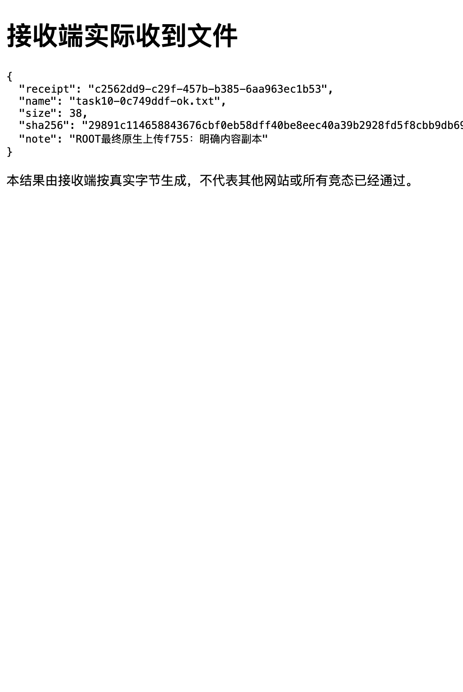

# 获准文件原生上传：契约与验收

状态：任务10已完成。构建`f755a57033c7`在官方macOS 27.0.1 Desktop 0.2.0-rc.2，通过真实Agent合法pre-step中的正式ToolRuntime、正式审批UI、实际OS选择器及同一可见共享页验收。G4上传部分与A12本切片通过；整个G4/G5、任务16和首版仍未通过，05/09/12保持blocked，13/14/16继续等待。

耐久事实、207个安全文件摘要及必要原始工具/接收端结果见[最终原生证据](evidence/native-upload-final.json)；固定公开源码与历史诊断见[证据索引](evidence/native-upload-verification.json)。CLI读取只能报告已记录的实际验收，不能因此声称当前机器重新执行过原生检查。

## 工具契约

所有动作使用当前真实会话的`pageId`与新`observe`铸造的`reference`，不接受宿主路径、模型字节、脚本、选择器、目录或其他会话身份。

| action | 附加参数、批准与结果 |
| --- | --- |
| `choose-file` | 先正式逐次批准当前页、网站及具体选择动作，说明选择即允许网站读取或立即上传；用户在原生OS界面确认具体文件。仅标准单文件input，当前最多16MiB。一次固定`showPicker()`调用先安装可信cancel/change监听，再等待真实结算。`cancelled`含取消或同文件未改变，无新授权，保留网站FileList；`selected`只表示本次选择和内容捕获完成，不是上传成功。 |
| `upload-submit` | 另带本页最近获准的`selectionId`，不授予路径权限。仅标准同页HTTP(S)、无URL凭据、POST multipart form提交按钮。另次正式审批展示具体内容副本名称、大小、完整SHA256、可读UTC捕获时间和Unix毫秒、目标网站及表单内容。发送前完整复核实际form对象身份、按钮override后的目标、普通/隐藏字段摘要和具体File对象/全文hash；变化停止，旧选择不重试。原生mouseDown/up发送完成只报`issued`，必须重新观察实际结果。 |

普通file点击或含非空FileList的普通输入继续拒绝，不能借通用click/fill绕过。当前顺序是先在空file表单填写普通说明，再choose-file；已有文件时普通fill仍拒绝。仅已核验的1倍缩放和当前主文档，目录、frame、未知目标、任意大小和其他宿主均不因本次验收变成已支持。

可信change且命令仍获准后，Client从同一input当前File捕获有界内容，完整解码并独立计算SHA256。公开`File`与`DataTransfer`把该内容构成不可变副本设回同一input；不合成change、不提交，不建立后台文件缓存。原始字节只在本次Client操作暂存，不进入Host工具结果、模型或持久文件。此链包含真实OS选择和权限、具体批准、内容副本、浏览器原生multipart以及独立接收端，不以单独字节注入冒充原生上传。

获准提交的是明确捕获时间的具体副本。原磁盘文件后续改写、删除或权限变化不会改变副本；使用新内容须重新选择。产品不宣称检测了这些后续磁盘变化，也不把FileList元数据当宿主真实路径或OS身份认证。网站自身处理器可能保存原File或立即发送，首次批准已说明交付风险；不承诺任意动态网页的原子事务或控制网站此后一切网络行为。

## 实际原生验收

最终正式调用覆盖turn46–51，r2补充覆盖turn30–45。主边界是真实工具与同一可见共享页；未调用模型step，也未操作真实账号。

| 任务10的五项验收 | 已核验事实 |
| --- | --- |
| 正式选择、权限与原生上传链 | 实际OS选择38B自有文件，Client摘要与获准内容一致；另次正式批准后原生form上传，同一pageId结果页、fresh observe和独立receiver均确认仅1请求/38B/SHA一致。公开File/DataTransfer步骤明确披露，不是孤立注入实验。 |
| 具体文件、网站、当前页绑定与复核 | r2首choose拒绝不打开OS，提交拒绝receiver0；人工更换FileList使旧selection发送前拒绝；待提交审批时官方reload，再点旧allow因文档变化拒绝。实际form对象、同文档action/字段变化另由真实工具→Connection→Client受控组合覆盖。 |
| 取消、权限、文件和目标变化结果明确 | r3捕获前000文件读取失败明确返回unknown，提示网站可能已读取、未建立副本、需核对重新授权，无selection、receiver0；同56B文件恢复0600后新tab/新批准selected。38B捕获后原文件改为51B并000，提交仍是明确获准的旧38B副本，不假称检测到了磁盘变更。 |
| 接管、关页、取消与迟到不重放 | chooser在途取消4秒后OS仍打开，job AbortError，另一真实observe明确unknown拒读；随后迟到选择56B不补成功、receiver不增长。实际结算后接管paused拒读，交回旧选择无效；待审批接管阻止OS启动，待审批关自有页返回closed/not-started。 |
| 公开能力与首版门禁 | 当前公开路径已形成上述完整纵向链，无未处理原生问题，任务10与G4上传/A12本切片通过；没有借下载延期缩减上传范围，其他首版阻塞继续保留。 |

最终receipt为`c2562dd9-c29f-457b-b385-6aa963ec1b53`，实际接收SHA256为`29891c114658843676cbf0eb58dff40be8eec40a39b2928fd5f8cbb9db694952`，说明为“ROOT最终原生上传f755：明确内容副本”。发送前后的pageId均为`3d2b6ae3-bb52-4cd9-930e-d41dc52da822`；原生form导航产生新documentId，不复用旧文档批准。

[原始收据WebP](evidence/native-upload-f755.webp)的SHA256为`476f1c5eff071416b3870f5c5269c3ff89adb8785d493534b196f3719ca042e7`，1151×1718、254536字节，RGBA透明底黑字，黑底查看会显黑。下图是明确标注的白底派生预览，已实际查看receipt、38B和说明；原始WebP字节未改。完整SHA以独立receiver与工具observe核对，不能靠右侧可能截断的图片文本证明。

## 撤销、失败与覆盖边界

复用任务07统一Broker许可、watch和input-drained屏障。取消/接管/关页先撤销结果许可；已started的Guest Promise仍须真实结算。未取得ACK只报告`unknown / cleanup-unconfirmed`，保留写屏障，不虚报停止，不自动重试。pause只清Agent引用，保留网站当前FileList。原生选择已发生后，内容读取失败仍是unknown，不能回退not-started。

OS modal期间底层接管/关页UI不可触达；没有声称原生点击了这些控件。picker在途取消与接管由上传组合直接验证；close/unload沿用通用页面生命周期/输入Promise共享屏障覆盖，未执行专用picker在途close用例。同文档form/action变化以已确认接缝上的真实工具→认证Connection→Client受控组合验证；替换的只是正式审批服务与原生guest外部边界。没有原生File读取计数器，不能把无成功结果/receiver不增夸大为原生零读取计数。真实网站/账号、模型自主选择工具及其他平台未执行，任务16仍未完成。

## 固定源码、历史失败与检查

固定DSH为`dsh-v0.2.0-rc.2`、commit`639ed015397290b3745d163aafe02ffee4aa3f84`；Electron44/Chromium152主源及逐文件URL/SHA保留于证据索引。File size/lastModified可为缓存snapshot；Blob异步捕获mtime，普通multipart另走路径与缓存mtime，网络检查容差小于1秒，没有前次内容hash/inode承诺。因此先前arrayBuffer摘要和路径上传不是同一不可变字节保证，本实现批准具体内容副本。

公开AttachmentStore不可变存储和可选Host路径、loadURL UploadFile也是调查过的正面路径，未因缺setInputFiles就断言不可能。但本任务实际验收选择上面的OS/具体副本/原生form链；未读已有用户附件，不把顶层POST冒充任意file-input，也不扩大为工具主动POST重定向控制。

早期ef8e诊断的日志route因Vite变换时序未插入，events文件为空，不能声称服务端记录；CUA实际cancel与unknown后的迟到choice事实保留。v2真实保持8秒并Cancel未复现断链，connected/gen3、99poll最大gap515ms，没有全局延租约修补；v1 AX长路径阶段的根因仍未唯一证明。r2的000失败仅获桥接泛化错误，与0600正控构成权限相关对照；r3只在capture的arrayBuffer拒绝处返回无内容read-failed，实际复测得到清晰unknown，其他检查异常不吞。

受控红绿覆盖完整工具链、内容副本、同form正向、属性相同另form迁移、目标/文件变化、旧选择不可重试及读取失败。旧默认1秒picker-start轮询曾在并行检查失败，清理还暴露悬空拒绝；统一改为fake公开showPicker实际启动ACK，并同时观察工具早拒绝，保留Vitest总timeout与产品timeout，不逐项加时碰绿。历史格式失败、等待失败、误并行check的-15和有效红例均保留，不计为通过。

最终Node24.21.0/pnpm11.7.0完整检查通过，24个测试文件、186项测试、0跳过；双轴审查新增/未解决均0。其后纯证据字段澄清与本次doc-only收尾不重复worker全检，本地只做文档lint和任务索引检查，merger负责最终整仓check。旧Node22警告与跳过日志保留，不覆盖成新的检查结果。

## 清理

原生验收已通过官方UI关闭全部自有tabs、卸载768/f755及driver5e945，legacy页保留；52983/50291/52081端口关闭，两个自有临时文件删除，四个profile文件字节一致，ASAR仍为原SHA`18d5036bbb58eaff41d351ede99314b8d06505aec06fb2e164c49874ada30f9e`。18个既有后台任务没有重启或取消。耐久证据不复制control/profile或合成文件字节，没有commit、push、远端事项或worktree归档。
